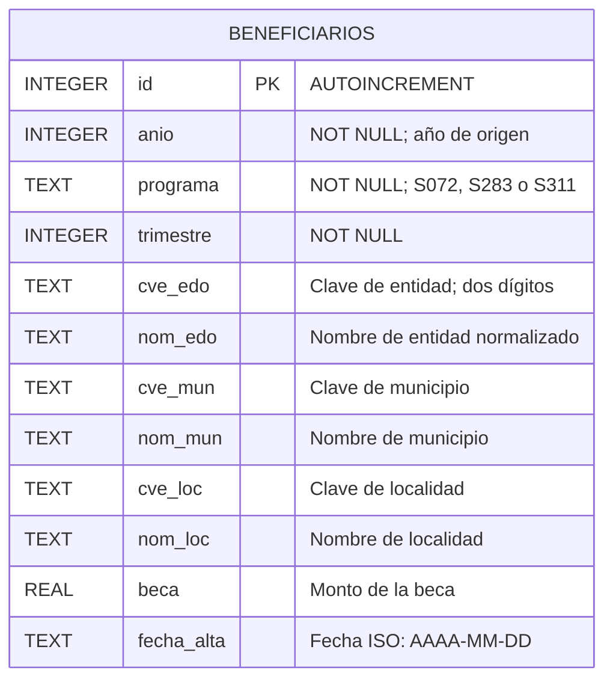
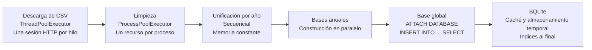

# Proceso ETL para Padrón consolidado de becas Benito Juárez

Este repositorio contiene el código fuente de una herramienta para descargar y consolidar los padrones públicos del Programa Nacional de Becas para el Bienestar Benito Juárez (CNBBBJ), publicados en [datos.gob.mx](https://www.datos.gob.mx/). El programa trabaja con los archivos disponibles de los programas de becas S072, S283 y S311.

El programa consulta el catálogo oficial, descarga y limpia los archivos CSV, y genera bases de datos SQLite y archivos unificados por año.

> [!NOTE]
> Los archivos de datos consolidados **no están incluidos en este repositorio de GitHub**. Puedes descargarlos desde los [datasets publicados en mi cuenta de Hugging Face](https://huggingface.co/datasets/rosendocamal/becas-beneficiarios).

## Fuente y cobertura

El comando `descubrir` consulta la API CKAN (`/api/3/action/package_search`) de `datos.gob.mx`. Busca los conjuntos de datos de la organización `cnbbbj` cuyos identificadores siguen el patrón `programa_nacional_becas_bienestar_benito_juarez_<año>_programa_s<NNN>`. Si hace falta, puedes indicar otro sitio con `--url-principal`.

El comando guarda en un manifiesto el año, el programa de beca, la entidad, el trimestre, la URL y el identificador de cada archivo. En el inventario consultado hay 24 conjuntos de datos (2019–2026) y 1,147 archivos CSV:

| Año | Trimestres publicados | Recursos CSV |
| --- | --- | ---: |
| 2019 | 4 | 92 |
| 2020–2024 | 4 por año | 96 por año |
| 2025 | 1, 2, 3 y 4 | 384 |
| 2026 | 2 y 3 | 191 |

Los nombres de archivo cambian de un año a otro. Algunos ejemplos son `4to_Trim2019`, `4to_Trimestre` y `2do_trimestre`. También varían las mayúsculas y la ortografía de los nombres de las entidades. Para no depender de esos cambios, el manifiesto se construye a partir de las URL y los identificadores de los conjuntos, no del título ni de una posición fija.

## Resultados y archivos generados

Al procesar el inventario anterior se obtuvieron 229,023,085 registros:

| Año | Registros |
| --- | ---: |
| 2019 | 11,855,589 |
| 2020 | 15,506,102 |
| 2021 | 16,598,253 |
| 2022 | 16,645,161 |
| 2023 | 16,754,385 |
| 2024 | 15,582,479 |
| 2025 | 85,686,052 |
| 2026 | 50,395,064 |
| **Total** | **229,023,085** |

El programa guarda los resultados en estas rutas:

| Ruta | Contenido |
| --- | --- |
| `data/raw/datos_gob_mx/manifiesto.json` | Inventario de recursos detectados. |
| `data/raw/datos_gob_mx/<año>/<programa>/` | Archivos CSV originales descargados. |
| `data/intermedios/datos_gob_mx/<año>/<programa>/` | CSV limpios, uno por recurso. |
| `data/entregables/csv/becas_<año>.csv` | CSV unificado por año, con los tres programas. |
| `data/entregables/db/becas_global.db` | Base SQLite con todos los años. |
| `data/entregables/db/por_anio/becas_<año>.db` | Base SQLite independiente por año. |

En esa ejecución, la base global ocupó 26.1 GiB y las ocho bases anuales sumaron 24.14 GiB. El tamaño puede variar según la versión de SQLite y el sistema.



## Instalación y requisitos

Necesitas Python 3.11 o una versión posterior y [`uv`](https://docs.astral.sh/uv/). Desde la carpeta del proyecto, instala las dependencias:

```bash
uv sync
```

## Uso

Para consultar los datos, descargarlos y generar las bases:

```bash
uv run becas todo
```

Si prefieres ejecutar el proceso por etapas, usa estos comandos en orden:

```bash
uv run becas descubrir
uv run becas descargar
uv run becas limpiar
uv run becas cargar
```

Cada comando realiza una etapa del proceso:

1. **`descubrir`** consulta el catálogo y actualiza el manifiesto.
2. **`descargar`** obtiene los CSV indicados en el manifiesto.
3. **`limpiar`** normaliza los archivos y genera un CSV unificado por año.
4. **`cargar`** construye la base global y las bases anuales.

Algunos ejemplos de opciones:

```bash
# Reconstruir las bases solo para 2022
uv run becas cargar --anio 2022

# Descargar de nuevo los archivos aunque ya existan
uv run becas descargar --fuerza

# Ejecutar todo con una sola tarea concurrente
uv run becas --secuencial todo

# Ajustar la concurrencia antes de ejecutar el subcomando
uv run becas --concurrencia-descarga 6 --concurrencia-limpieza 8 todo
```

Escribe las opciones generales antes del subcomando. Puedes cambiar el sitio (`--url-principal`), la organización (`--organizacion`) y la ruta del manifiesto (`--manifiesto`). Para la carga, también puedes ajustar el tamaño del lote (`--lote`) y la memoria caché (`--cache-mib`).

### Descarga de los CSV

De forma predeterminada, el programa obtiene los datos del datastore de CKAN usando el identificador de cada recurso. Solicita hasta 32,000 filas por página e indica qué columnas necesita. Si la consulta falla, intenta descargar el CSV original directamente con `curl_cffi`, que imita la huella TLS de Chrome.

La opción global `--fuente-csv` admite tres modos:

- `datastore` (predeterminado): consulta primero CKAN y recurre a la descarga directa si la consulta falla.
- `directo`: descarga directamente los CSV originales, sin recurrir al datastore.
- `auto`: intenta primero la descarga directa y, si falla, usa el datastore.

Antes de guardar un archivo, el programa comprueba que la descarga tenga formato CSV. Si vuelves a ejecutar el comando, conserva y reutiliza los archivos existentes no vacíos. Añade `--fuerza` para descargarlos de nuevo. Los archivos temporales incompletos no se usan en la consolidación.

## Criterios de consolidación

- Cada informe trimestral incluye los registros de los trimestres anteriores. Se conserva el historial, pero **no vayas sumar los trimestres** para obtener un total anual, en su lugar, usa el último informe publicado para ese año.
- Las claves de entidad se normalizan a dos dígitos y los nombres se homologan con un catálogo canónico de las 32 entidades federativas.
- Las fechas se convierten al formato ISO y los importes a `REAL`. Los valores que no pueden interpretarse quedan como `NULL`.
- Al reconstruir un año, el programa reemplaza sus registros en las bases correspondientes. De esta manera, se evita la duplicación de datos.
- El CSV anual unificado es la fuente de las bases de datos anuales y global.

## Rendimiento

Al iniciar, el programa calcula los recursos disponibles a partir del número de CPU y la memoria libre (`/proc/meminfo`, con `os.sysconf` como alternativa). Reserva memoria para el sistema y ajusta la concurrencia, el tamaño de los lotes y la caché de SQLite. Puedes cambiar estos valores con las opciones de la línea de comandos.

En el equipo de referencia (12 CPU, 23 GiB de memoria total y 18 GiB disponibles), el programa configuró 8 descargas simultáneas, 10 procesos de limpieza o carga, lotes de 20,000 filas, una caché de 512 MiB y fragmentos de descarga de 1 MiB.



## Solución de problemas

### Error `403`

El programa envía encabezados HTTP similares a los de un navegador y reintenta algunos errores temporales. Aun así, el servidor o la red pueden rechazar la solicitud.

1. Vuelve a ejecutar el mismo comando. No borres los archivos existentes.
2. Si el error ocurre al descargar, prueba con una sola tarea a la vez:

   ```bash
   uv run becas --secuencial descargar
   ```

3. Si sigue fallando, guarda el comando y el mensaje completo. No cambies `--url-principal` ni borres archivos sin saber cuál es la causa.

### Error durante la descarga

- Al repetir `descargar`, se reutilizan los archivos existentes no vacíos. No borres los que ya se descargaron correctamente.
- Para reemplazarlos, ejecuta `uv run becas descargar --fuerza`.
- Si CKAN no ofrece un recurso (por ejemplo, responde `404`), el programa intenta descargar el CSV directamente. También puedes probar `--fuente-csv directo` o `--fuente-csv auto`.
- Si los problemas de red continúan, reduce la concurrencia con `--secuencial` o `--concurrencia-descarga`.

### Error durante la limpieza o la carga

- No uses los archivos que generó una etapa si esta terminó con errores.
- Vuelve a ejecutar la etapa que falló. Si cambió el catálogo, actualiza primero el manifiesto con `descubrir` y luego repite las etapas necesarias.
- Si el error menciona encabezados, columnas o cantidades de registros, quizá cambió el formato de los datos. Anota el comando, el mensaje y el año o recurso afectado; esos detalles permitirán determinar si hay que modificar el código.

### Comprobación de una ejecución

- El comando debe terminar sin mostrar un `Traceback`.
- Comprueba que se hayan creado la base global (`data/entregables/db/becas_global.db`), las bases anuales (`data/entregables/db/por_anio/becas_<año>.db`) y los CSV (`data/entregables/csv/becas_<año>.csv`).
- `cargar` muestra cuántos registros hay por año y en total. La cifra de 229,023,085 corresponde al inventario consultado y puede cambiar si se actualiza la fuente.

Si el problema persiste tras dos intentos, comparte el comando exacto, las últimas 20 líneas del mensaje y el año o recurso afectado.

## Pruebas y verificaciones

Los tests usan datos sintéticos y no requieren conexión a internet:

```bash
uv run ruff check .
uv run ruff format --check .
uv run mypy
uv run pytest
```

## Licencia y atribución

Los datos son abiertos y se publican bajo la licencia **Creative Commons Attribution 4.0 (CC BY 4.0)**, según la información de [datos.gob.mx](https://www.datos.gob.mx/).

El código de este proyecto se distribuye bajo la licencia MIT. Esta licencia no cubre ni condiciona los datos. Consulta el archivo [LICENSE](LICENSE).

## Autor

Desarrollado por [Rosendo Camal](https://github.com/rosendocamal).

- [GitHub](https://github.com/rosendocamal)
- [LinkedIn](https://www.linkedin.com/in/rosendocamal)
- [Hugging Face](https://huggingface.co/rosendocamal/)